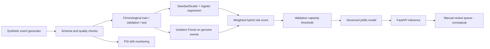

# System architecture and decisions

## Senior-level controls

- Labels assumed to be available after a delay; this example does **not** simulate label maturity or chargeback lag. Real deployments must enforce label cutoff dates.
- Never include post-decision signals (chargeback status, investigation outcome) as features.
- Chronological holdout limits time leakage, but repeated entities across splits can still cause dependence; add group/time embargo in a real dataset.
- Fit all transformations on the train set. Tune the anomaly mixing weight and review threshold using validation only. Test once.
- Review threshold reflects a review *fraction*, not a fraud probability or business-optimal monetary cost.
- Balanced logistic classifier scores are **not calibrated** probabilities. They are risk ranking scores.
- Isolation Forest tail percentile is referenced to legitimate training examples; its output is not a probability of fraud.
- Training locally persists a pickle-based artifact: never unpickle untrusted files.
- Artifacts are generated locally and intentionally omitted from version control. Docker builds generate a synthetic demonstration model.

## Suggested enterprise upgrade path

1. Data contracts (Pandera/Great Expectations), event/label tables, point-in-time joins and late-arriving labels.
2. Entity velocity features in Redis + offline/online consistency tests; event streaming (Kafka).
3. LightGBM/XGBoost with nested temporal validation, calibration and segment/merchant evaluations.
4. MLflow registry and immutable object storage; DVC/data lineage; deployment via CI/CD and shadow/canary modes.
5. Prometheus/OpenTelemetry with alert thresholds for latency, decision volume, PSI, precision from mature labels and drift.
6. Cost model: false-positive operations cost vs loss prevented, manual-review capacity and fairness audit.
